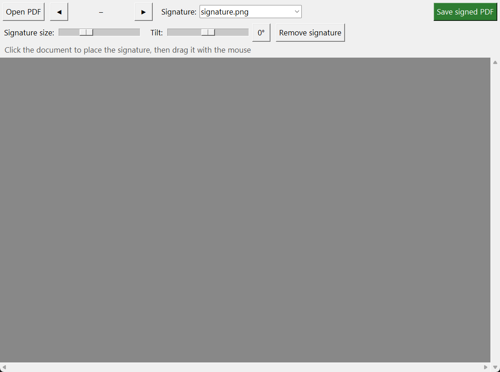
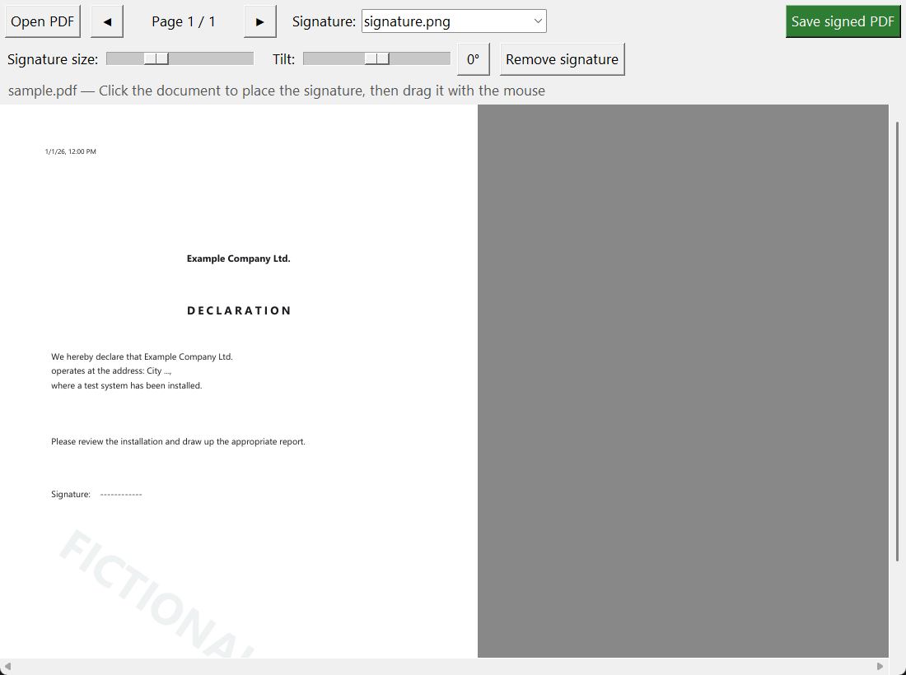
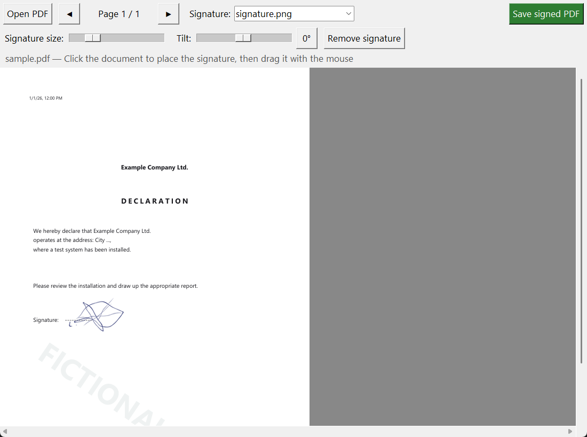

# PDF Signer By Levan: User Guide

Place a signature image on a PDF without printing or scanning it.

> **Important:** use a signature only with the signature owner's permission.
> The tool places an *image* of a signature; it is not a cryptographic digital signature.

## What changes

| Before (5 steps) | Now (3 steps) |
| --- | --- |
| 1. Download the PDF | 1. Download the PDF |
| 2. ~~Print it~~ | 2. Sign it with PDF Signer |
| 3. ~~Get it signed by hand~~ | 3. Upload / send it |
| 4. ~~Scan the signed copy~~ | |
| 5. Upload / send it | |

## 1. Launch the program

1. Extract the archive you received (or build the exe, see the [README](../README.md#build-the-exe)).
2. Keep `PDF Signer By Levan.exe` and the signature file (`signature.png`) in the **same folder**.
3. Double-click the exe. No installation or extra software is needed.

> **Windows warning:** if you see "Windows protected your PC", click **More info**, then **Run anyway**.
> The exe is not code-signed, so Windows does not recognise the publisher.

## 2. Sign a document

1. Click **Open PDF** and choose the document.
2. Pick a signature in the **Signature:** dropdown (only needed if you have several).
3. Click the page where the signature should go. Drag it with the mouse to fine-tune.
4. Optional: change **Signature size** and **Tilt**. The `0°` button resets the tilt.
5. Click **Save signed PDF** and choose a file name.

After saving you are asked **Sign another document?** Click **Yes** to continue or **No** to exit.

The original file is never modified. The signed copy is saved as a new file (default name `<name>_signed.pdf`).

### Multi-page documents

Use the `◀` and `▶` buttons to switch pages. The signature is placed on each page separately,
so click on every page that needs one.

## Tips

| Topic | How |
| --- | --- |
| Remove a signature | **Remove signature** button or the `Delete` key (current page only) |
| Several signatures | Put `signature1.png`, `signature2.png`, ... next to the exe. They appear in the dropdown |
| Password-protected PDF | Cannot be opened; remove the password first |
| Try it out | Use the fictional files in [`samples/`](../samples) |

## Preparing your signature file

- PNG with a **transparent background** works best.
- Sign with a dark pen on white paper, photograph or scan it, remove the background, and crop closely.
- Name it `signature.png` (or `signatureN.png` for extra ones) and place it next to the exe.
